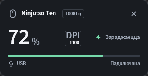

[English](README.md) · [Русский](README.ru.md) · **Беларуская** · [Қазақша](README.kk.md) · [简体中文](README.zh-CN.md)

# Ninjutso Battery Tray

[](Cargo.toml)
[](https://github.com/DrStopor/ninjutso-battery-tray/releases/latest)


[](rust-toolchain.toml)
[](https://crates.io/crates/gpui/0.2.2)
[](installer/ninjutso-battery-tray.iss)
[](LICENSE)

Акуратная ўтыліта для Windows і Linux, з якой зарад Ninjutso Ten заўсёды навідавоку — без неабходнасці адкрываць паўнавартасную праграму вытворцы.



На здымку дэманстрацыйныя даныя; праграма счытвае зарад вашай мышы.

## Магчымасці

- **Дакладны зарад проста ў трэі.** Высокакантрасныя лічбы застаюцца чытэльнымі ў сапраўдным памеры значка вобласці апавяшчэнняў.
- **Прыёмнік і правадное USB-падключэнне.** Утыліта счытвае зарад праз бесправадны прыёмнік і падчас зараджання мышы праз USB.
- **Кампактная картка на GPUI.** Памер 304 × 156 лагічных пікселяў, выразныя вектарныя значкі, светлая/цёмная тэма Windows і жывыя станы падключэння.
- **Частата апытання побач з назвай.** Контурны бейдж паказвае наладу актыўнага профілю, прачытаную з мышы. Калі частата недаступная, бейдж хаваецца, а зарад застаецца даступным.
- **Асобны DPI-бейдж.** Двухрадковы контурны блок знаходзіцца паміж зарадам і станам сілкавання: буйны надпіс `DPI` зверху, значэнне пад ім справа. Недаступны DPI хаваецца.
- **Аўтаматычнае і ручное абнаўленне.** Даныя абнаўляюцца раз на хвіліну, а ў меню ёсць абнаўленне па запыце.
- **Лакальна і прыватна.** Без воблака, уліковага запісу, сеткавых злучэнняў і тэлеметрыі.
- **Абарона ад некалькіх запускаў.** Паўторны запуск не стварае дублікаты значка ў трэі.
- **Пяць моў інтэрфейсу.** Англійская, руская, беларуская, казахская і спрошчаная кітайская.

## Прылады, якія падтрымліваюцца

Цяпер Ninjutso Battery Tray падтрымлівае **Ninjutso Ten** пры падключэнні:

- праз бесправадны прыёмнік;
- праз USB-кабель, у тым ліку падчас зараджання.

Калі мыш не знойдзена, падключыце яе праз USB або ўключыце, затым выберыце **Абнавіць** у меню трэя.

## Linux (эксперыментальная падтрымка)

Асноўныя мэтавыя сістэмы — **Debian 13 і Ubuntu 26.04, x86-64**. Патрэбныя X11/XWayland, Vulkan і падтрымка StatusNotifierItem у трэі. Натыўны Wayland пакуль не падтрымліваецца. Збярыце лакальны `.deb` паводле [кіраўніцтва для Linux](docs/linux.md), затым усталюйце:

```sh
sudo apt install ./ninjutso-battery-tray_0.3.0_amd64.deb
```

Пасля ўсталявання правіла udev з пакета падключыце мыш або прыёмнік нанова. Запускайце праграму звычайным карыстальнікам, без `sudo`. Калі ў GNOME няма значка, уключыце пашырэнне AppIndicator. Пункт **Адкрыць картку** працуе і там, дзе левы клік адкрывае меню. Колеры сістэмнага меню Linux вызначае абалонка; картка падтрымлівае ўсе чатыры тэмы праграмы.

Падтрымка Linux з'явілася ў **0.3.0** і застаецца эксперыментальнай. Правераны Debian 13/GNOME з XWayland і фізічнай мышшу праз USB-перадачу VMware; праверкі Ubuntu 26.04, KDE і Linux на фізічным камп'ютары яшчэ наперадзе. Калі на старонцы рэлізу няма адпаведных Linux-пакетаў, збярыце іх з гэтых зыходнікаў. Вядомыя абмежаванні і абыход праблемы фізічнага адключэння ў VMware апісаныя ў кіраўніцтве.

## Усталяванне ў Windows

[**Спампуйце апошні выпуск з GitHub.**](https://github.com/DrStopor/ninjutso-battery-tray/releases/latest)

- Для большасці карыстальнікаў падыходзіць `NinjutsoBatteryTraySetup-*.exe`: ён дадае аўтазапуск і стандартнае выдаленне праз Windows.
- Для запуску без усталявання скарыстайцеся `ninjutso-battery-tray-*-portable.zip`.
- У `SHA256SUMS.txt` знаходзяцца кантрольныя сумы для праверкі спампаваных файлаў.

Прадвызначана праграма ўсталёўваецца толькі для бягучага карыстальніка і не патрабуе правоў адміністратара. У майстры таксама можна ўключыць аўтазапуск або выбраць усталяванне для ўсіх карыстальнікаў. Майстар даступны на англійскай, рускай, беларускай, казахскай і спрошчанай кітайскай мовах.

Пасля запуску праграма з’яўляецца толькі ў сістэмным трэі. Windows можа схаваць новы значок за стрэлкай схаваных значкоў; перацягніце яго ў асноўную вобласць апавяшчэнняў, калі хочаце бачыць яго заўсёды.

## Выкарыстанне

Націсканне левай кнопкай на значок адкрывае картку. Закрыць яе можна крыжыкам ×, клавішай `Esc`, паўторным націсканнем на значок або па-за карткай. Націсканне на змесціва пакідае яе адкрытай. Пакуль картка бачная, даныя абнаўляюцца раз на секунду: USB, прыёмнік, зараджанне і адключэнне адлюстроўваюцца без паўторнага адкрыцця.

Націсканне правай кнопкай адкрывае меню:

- **Абнавіць** — перачытаць зарад;
- **Паказваць працэнт** — пераключыць лічбавы і графічны варыянты значка;
- **Мова** — змяніць мову інтэрфейсу;
- **Тэма** — Аўта (як у сістэме), Светлая, Цёмная або NinjaForce;
- **Выхад** — закрыць праграму.

У лічбавым рэжыме колер контуру паказвае дыяпазон зараду: зялёны — 50–100%, бурштынавы — 20–49%, чырвоны — 0–19%. Дакладныя станы зараджання і падключэння заўсёды даступныя ў картцы і падказцы.

Выбраныя мова, варыянт значка і тэма захоўваюцца аўтаматычна. У Windows картка і меню трэя, уключаючы падменю, выкарыстоўваюць адну тэму. У рэжыме «Аўта» яны адпавядаюць тэме праграм Windows; «Светлая», «Цёмная» і NinjaForce дзейнічаюць незалежна ад сістэмы, без перазапуску. NinjaForce спалучае светла-бэзавы фон з сінім колерам тэксту і акцэнтаў афіцыйнай праграмы, захоўваючы чытальнасць дробных надпісаў і адрозныя колеры папярэджанняў пра зарад. Колеры значка ў трэі застаюцца кантраснымі ва ўсіх тэмах.

## Мовы

Інтэрфейс даступны на англійскай, рускай, беларускай, казахскай і спрошчанай кітайскай (`zh-CN`) мовах. Пры першым запуску праграма выкарыстоўвае мову інтэрфейсу Windows або лакаль Linux, калі яны падтрымліваюцца, інакш — англійскую.

Пераклад `zh-CN` — спрошчаная кітайская для мацерыковага Кітая.

## Кіраванне ўсталяваннем

### Аўтазапуск

Запусціце ўсталёўшчык яшчэ раз, каб уключыць або выключыць пункт **Запускаць разам з Windows**.

### Абнаўленне

Спампуйце новы ўсталёўшчык і запусціце яго паверх усталяванай версіі. Рэжым усталявання і налады праграмы захаваюцца.

### Выдаленне

Адкрыйце **Налады Windows → Праграмы → Усталяваныя праграмы**, знайдзіце **Ninjutso Battery Tray** і выберыце **Выдаліць**.

## Прыватнасць

Даныя пра зарад счытваюцца лакальна праз Windows HID API або Linux hidraw. Праграма нічога нікуды не адпраўляе і не змяшчае аналітыкі, рэкламы або фонавай праверкі абнаўленняў.

## Падтрымка

[Стварыце зварот на GitHub](https://github.com/DrStopor/ninjutso-battery-tray/issues) і пазначце аперацыйную сістэму і яе версію, спосаб падключэння (прыёмнік або USB) і версію праграмы. Для Linux таксама пазначце асяроддзе працоўнага стала і тып сеанса: X11 або Wayland/XWayland.

## Ліцэнзія

Праект распаўсюджваецца пад [ліцэнзіяй MIT](LICENSE). Дазволены выкарыстанне, змяненне, распаўсюджванне і продаж, у тым ліку ў складзе зборак ПЗ і дыстрыбутываў, пры захаванні паведамлення аб аўтарскіх правах і тэксту ліцэнзіі.

Убудаваныя шрыфты Source Sans 3 і Noto Sans SC захоўваюць ліцэнзію SIL OFL 1.1; гл. [ліцэнзіі і паходжанне шрыфтоў](assets/fonts/UPSTREAM.md). Яна таксама дазваляе распаўсюджванне разам з ПЗ, уключаючы камерцыйныя зборкі.

Староннія кампаненты, у тым ліку GPUI, захоўваюць уласныя ліцэнзіі: [THIRD_PARTY_NOTICES.txt](THIRD_PARTY_NOTICES.txt).

<details>
<summary><strong>Зборка з зыходнага кода</strong></summary>

Патрабаванні:

- Windows x64; інтэрфейс GPUI выкарыстоўвае DirectX 11;
- MSVC C++ Build Tools;
- Rust 1.100.0 з Cargo; версія замацавана ў [rust-toolchain.toml](rust-toolchain.toml);
- Windows SDK з `rc.exe` і `fxc.exe` (кампілятар шэйдараў для release-зборкі);
- Inno Setup 6.7.4 або навейшы для зборкі ўсталёўшчыка.

```powershell
cargo test --workspace
cargo build --release
```

Пераносімая логіка і агульны канвеер чытання тэлеметрыі знаходзяцца ў [пакеце ядра](crates/core/Cargo.toml) без знешніх залежнасцей і з забаронай unsafe-кода. Каманда `cargo test -p ninjutso-battery-core` правярае яго асобна на Windows або Linux. Натыўная зборка, упакоўка і праверкі інтэрфейсу апісаныя ў [кіраўніцтве для Linux](docs/linux.md).

Першая зборка GPUI спампоўвае больш залежнасцяў. Калі `fxc.exe` няма ў PATH, пазначце поўны шлях у `GPUI_FXC_PATH`. Скрыпты ўпакоўкі і праверкі таксама знаходзяць усталяваныя SDK.

Папярэдні інтэрфейс Win32 даступны як рэзервовая зборка:

```powershell
cargo build --no-default-features --target-dir target/native
```

Праверка інтэрфейсу і ўзнаўляльныя прэв’ю для ўсіх пяці моў:

```powershell
.\tools\smoke-ui.ps1
```

Пасля змены залежнасцяў усталюйце `cargo-about 0.9.3` з `--features cli` і абнавіце ліцэнзіі праз [tools/update-licenses.ps1](tools/update-licenses.ps1). Звычайная зборка і ўпакоўка выкарыстоўваюць захаваныя апавяшчэнні і не патрабуюць гэтага інструмента.

Сабраць усе файлы выпуску:

```powershell
.\tools\package-release.ps1
```

Выканальны файл з’явіцца ў `target\release\ninjutso-battery-tray.exe`, а гатовыя пакеты — у `dist`. Апісанне HID-пратаколу для распрацоўшчыкаў знаходзіцца ў [docs/hid-protocol.md](docs/hid-protocol.md), гісторыя змен — у [CHANGELOG.md](CHANGELOG.md).

Поўная праверка праз [tools/verify.ps1](tools/verify.ps1) таксама правярае версіі, значкі і лакальныя спасылкі ва ўсіх README.

</details>
