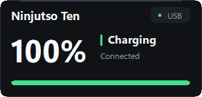

**English** · [Русский](README.ru.md) · [Беларуская](README.be.md) · [Қазақша](README.kk.md) · [简体中文](README.zh-CN.md)

# Ninjutso Battery Tray

[](https://github.com/DrStopor/ninjutso-battery-tray/releases/latest)

[](Cargo.toml)
[](installer/ninjutso-battery-tray.iss)
[](LICENSE)

A focused Windows tray utility that keeps your Ninjutso Ten battery level visible without opening a full companion app.



## Highlights

- **Exact battery level in the tray.** High-contrast digits remain legible at the notification area's real icon size.
- **Receiver and wired USB support.** The app reads the battery through the wireless receiver and while the mouse is charging over USB.
- **A calm, compact flyout.** One left click shows the percentage, connection source, charging state, and connection state.
- **Automatic and manual refresh.** Battery data updates every minute, with an on-demand refresh in the tray menu.
- **Local and private.** No cloud service, account, network access, or telemetry.
- **Single-instance protection.** Starting the app again never creates duplicate tray icons.
- **Five interface languages.** English, Russian, Belarusian, Kazakh, and Simplified Chinese.

## Supported hardware

Ninjutso Battery Tray currently supports the **Ninjutso Ten** through:

- its wireless receiver;
- a wired USB connection, including while the mouse is charging.

If the mouse is not detected, connect it by USB or turn it on, then select **Refresh** from the tray menu.

## Installation

[**Download the latest release from GitHub.**](https://github.com/DrStopor/ninjutso-battery-tray/releases/latest)

- For most people, use `NinjutsoBatteryTraySetup-*.exe`. It provides autostart and standard Windows uninstall support.
- For a no-install option, use `ninjutso-battery-tray-*-portable.zip`.
- `SHA256SUMS.txt` contains checksums for verifying downloaded files.

The installer targets the current user by default and does not require administrator rights. Its wizard can also enable autostart or switch to an all-users installation. The wizard is available in English, Russian, Belarusian, Kazakh, and Simplified Chinese.

After launch, the app appears only in the system tray. Windows may place a new icon behind the hidden-icons arrow; drag it into the main notification area if you want it always visible.

## Using the app

Left-click the tray icon to open the status card. Clicking the icon again, clicking outside the card, or pressing `Esc` closes it. Clicking inside the card keeps it open. While visible, the card updates automatically and follows transitions between USB, the receiver, and a disconnected mouse.

Right-click the icon to open the menu:

- **Refresh** — read the battery again;
- **Show percentage** — switch between the numeric and graphical tray icons;
- **Language** — change the interface language;
- **Exit** — close the app.

In numeric mode, the colored edge communicates the battery range: green for 50–100%, amber for 20–49%, and red for 0–19%. The exact charging and connection states remain available in the flyout and tooltip.

The selected language and icon mode are saved automatically.

## Languages

The interface includes English, Russian, Belarusian, Kazakh, and Simplified Chinese (`zh-CN`). On first launch, the app follows the Windows display language when it is supported and otherwise falls back to English.

The `zh-CN` translation uses Simplified Chinese for mainland China.

## Managing the installation

### Autostart

Run the installer again to enable or disable **Start with Windows**.

### Updating

Download the new installer and run it over the existing installation. Your install mode and app settings are preserved.

### Uninstalling

Open **Windows Settings → Apps → Installed apps**, find **Ninjutso Battery Tray**, and select **Uninstall**.

## Privacy

Battery data is read locally through the Windows HID API. The app does not send data anywhere and contains no analytics, advertising, or background update checker.

## Support

[Open an issue on GitHub](https://github.com/DrStopor/ninjutso-battery-tray/issues) and include your Windows version, connection type (receiver or USB), and app version.

## License

The source may be used, copied, modified, and redistributed under the terms in [LICENSE](LICENSE). The Commons Clause forbids selling the utility itself or a product or service whose value derives substantially from it. This is a source-available project, not OSI open source.

<details>
<summary><strong>Build from source</strong></summary>

Requirements:

- Windows;
- a Rust toolchain with Cargo;
- Windows SDK with `rc.exe` for embedding the executable icon;
- Inno Setup 6 for building the installer.

```powershell
cargo test
cargo build --release
```

Build every release artifact with:

```powershell
.\tools\package-release.ps1
```

The release executable is written to `target\release\ninjutso-battery-tray.exe`; packaged artifacts are written to `dist`. Protocol notes for contributors are in [docs/hid-protocol.md](docs/hid-protocol.md), and release changes are tracked in [CHANGELOG.md](CHANGELOG.md).

</details>
