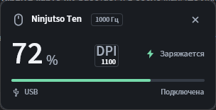

[English](README.md) · **Русский** · [Беларуская](README.be.md) · [Қазақша](README.kk.md) · [简体中文](README.zh-CN.md)

# Ninjutso Battery Tray

[](Cargo.toml)
[](https://github.com/DrStopor/ninjutso-battery-tray/releases/latest)

[](rust-toolchain.toml)
[](installer/ninjutso-battery-tray.iss)
[](LICENSE)

Аккуратная утилита для Windows, с которой заряд Ninjutso Ten всегда на виду — без необходимости открывать полноценное приложение-компаньон.



## Возможности

- **Точный заряд прямо в трее.** Высококонтрастные цифры читаются в реальном размере значка области уведомлений.
- **Приёмник и проводной USB.** Утилита читает заряд через беспроводной приёмник и во время зарядки мыши по USB.
- **Спокойное компактное окно.** Один клик левой кнопкой показывает процент, способ подключения, состояние зарядки и соединения.
- **Автоматическое и ручное обновление.** Данные обновляются раз в минуту, а в меню есть обновление по запросу.
- **Локально и приватно.** Без облака, учётной записи, сетевых подключений и телеметрии.
- **Защита от мультизапуска.** Повторный запуск не создаёт дубликаты значка в трее.
- **Пять языков интерфейса.** Английский, русский, белорусский, казахский и упрощённый китайский.

## Поддерживаемые устройства

Сейчас Ninjutso Battery Tray поддерживает **Ninjutso Ten** при подключении:

- через беспроводной приёмник;
- по USB-кабелю, в том числе во время зарядки.

Если мышь не найдена, подключите её по USB или включите, затем выберите **Обновить** в меню трея.

## Установка

[**Скачайте последний релиз с GitHub.**](https://github.com/DrStopor/ninjutso-battery-tray/releases/latest)

- Для большинства пользователей подходит `NinjutsoBatteryTraySetup-*.exe`: он добавляет автозапуск и стандартное удаление через Windows.
- Для запуска без установки используйте `ninjutso-battery-tray-*-portable.zip`.
- В `SHA256SUMS.txt` находятся контрольные суммы для проверки скачанных файлов.

По умолчанию приложение устанавливается только для текущего пользователя и не требует прав администратора. В мастере можно также включить автозапуск или выбрать установку для всех пользователей. Мастер доступен на английском, русском, белорусском, казахском и упрощённом китайском.

После запуска приложение появляется только в системном трее. Windows может спрятать новый значок за стрелкой скрытых значков; перетащите его в основную область уведомлений, если хотите видеть его всегда.

## Использование

Клик левой кнопкой по значку открывает карточку состояния. Повторный клик по значку, клик вне карточки или клавиша `Esc` закрывают её. Клик внутри карточки оставляет окно открытым. Пока карточка видна, она обновляется автоматически и без переоткрытия показывает переходы между USB, приёмником и отключённой мышью.

Клик правой кнопкой открывает меню:

- **Обновить** — перечитать заряд;
- **Показать процент** — переключить цифровой и графический варианты значка;
- **Язык** — сменить язык интерфейса;
- **Выход** — закрыть приложение.

В цифровом режиме цвет контура показывает диапазон заряда: зелёный — 50–100%, янтарный — 20–49%, красный — 0–19%. Точные состояния зарядки и подключения всегда доступны в карточке и подсказке.

Выбранный язык и вариант значка сохраняются автоматически.

## Языки

Интерфейс доступен на английском, русском, белорусском, казахском и упрощённом китайском (`zh-CN`). При первом запуске приложение использует язык интерфейса Windows, если он поддерживается, иначе — английский.

Перевод `zh-CN` — упрощённый китайский для материкового Китая.

## Управление установкой

### Автозапуск

Запустите установщик ещё раз, чтобы включить или выключить пункт **Запускать вместе с Windows**.

### Обновление

Скачайте новый установщик и запустите его поверх установленной версии. Режим установки и настройки приложения сохранятся.

### Удаление

Откройте **Параметры Windows → Приложения → Установленные приложения**, найдите **Ninjutso Battery Tray** и нажмите **Удалить**.

## Приватность

Данные о заряде читаются локально через Windows HID API. Приложение ничего никуда не отправляет и не содержит аналитики, рекламы или фоновой проверки обновлений.

## Поддержка

[Создайте обращение на GitHub](https://github.com/DrStopor/ninjutso-battery-tray/issues) и укажите версию Windows, способ подключения (приёмник или USB) и версию приложения.

## Лицензия

Исходный код можно использовать, копировать, изменять и распространять на условиях из файла [LICENSE](LICENSE). Commons Clause запрещает продавать саму утилиту либо продукт или услугу, ценность которых существенно основана на ней. Это source-available проект, а не open-source проект в смысле OSI.

<details>
<summary><strong>Сборка из исходников</strong></summary>

Требования:

- Windows;
- Rust 1.100.0 с Cargo; версия закреплена в [rust-toolchain.toml](rust-toolchain.toml);
- Windows SDK с `rc.exe` для встраивания значка в исполняемый файл;
- Inno Setup 6.7.4 или новее для сборки установщика.

```powershell
cargo test
cargo build --release
```

Собрать все релизные файлы:

```powershell
.\tools\package-release.ps1
```

Исполняемый файл появится в `target\release\ninjutso-battery-tray.exe`, а готовые пакеты — в `dist`. Описание HID-протокола для разработчиков находится в [docs/hid-protocol.md](docs/hid-protocol.md), история изменений — в [CHANGELOG.md](CHANGELOG.md).

Полная проверка через [tools/verify.ps1](tools/verify.ps1) также проверяет версии, бейджи и локальные ссылки во всех README.

</details>
