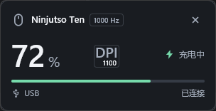

[English](README.md) · [Русский](README.ru.md) · [Беларуская](README.be.md) · [Қазақша](README.kk.md) · **简体中文**

# Ninjutso Battery Tray

[](Cargo.toml)
[](https://github.com/DrStopor/ninjutso-battery-tray/releases/latest)

[](rust-toolchain.toml)
[](https://crates.io/crates/gpui/0.2.2)
[](installer/ninjutso-battery-tray.iss)
[](LICENSE)

一款专注、轻量的 Windows 托盘工具，无需打开完整的配套软件，即可随时查看 Ninjutso Ten 的电量。



截图使用演示数据；运行中的应用读取您的鼠标电量。

## 功能亮点

- **托盘内直接显示精确电量。** 高对比度数字在通知区域的实际图标尺寸下依然清晰。
- **同时支持接收器和有线 USB。** 无论通过无线接收器连接，还是使用 USB 为鼠标充电，都能读取电量。
- **紧凑的 GPUI 状态卡片。** 304 × 156 逻辑像素布局、清晰的矢量图标，自动跟随 Windows 明暗主题并实时更新连接状态。
- **设备名称旁的轮询率。** 描边徽标显示从鼠标读取的当前配置文件轮询率；读取不到时隐藏徽标，不影响电量显示。
- **独立 DPI 徽标。** 双行描边徽标位于电量与供电状态之间：上方显示较大的 `DPI`，下方数值右对齐且不超出标签宽度；读取不到时隐藏。
- **自动与手动刷新。** 电量每分钟自动更新，也可从托盘菜单立即刷新。
- **本地且注重隐私。** 无云服务、无需账户、不访问网络、无遥测。
- **单实例保护。** 再次启动应用不会产生重复的托盘图标。
- **五种界面语言。** 英语、俄语、白俄罗斯语、哈萨克语和简体中文。

## 支持的设备

Ninjutso Battery Tray 目前支持 **Ninjutso Ten** 的以下连接方式：

- 无线接收器；
- 通过 USB 有线连接，包括鼠标充电时。

如果未检测到鼠标，请通过 USB 连接鼠标或将其开启，然后在托盘菜单中选择 **刷新**。

## 安装

[**从 GitHub 下载最新版本。**](https://github.com/DrStopor/ninjutso-battery-tray/releases/latest)

- 建议大多数用户下载 `NinjutsoBatteryTraySetup-*.exe`，它支持开机自启和 Windows 标准卸载。
- 如需免安装使用，请下载 `ninjutso-battery-tray-*-portable.zip`。
- `SHA256SUMS.txt` 提供用于校验下载文件的哈希值。

默认仅为当前用户安装，无需管理员权限。安装向导还可启用开机自启，或切换为所有用户安装。向导提供英语、俄语、白俄罗斯语、哈萨克语和简体中文。

启动后，应用只会出现在系统托盘中。Windows 可能将新图标收进“隐藏的图标”区域；如需始终显示，请将图标拖到通知区域的可见区域。

## 使用方法

左键单击托盘图标可打开卡片。点击 ×、按下 `Esc`、再次点击图标或点击卡片外部均可关闭；点击状态内容则保持打开。卡片显示时每秒刷新数据，无需重新打开即可查看 USB、接收器、充电与断开连接的变化。

右键单击图标可打开菜单：

- **刷新** — 重新读取电量；
- **显示电量百分比** — 在数字图标和图形图标之间切换；
- **语言** — 更改界面语言；
- **主题** — 跟随系统、浅色、深色或 NinjaForce；
- **退出** — 关闭应用。

在数字模式下，边框颜色表示电量区间：绿色为 50–100%，琥珀色为 20–49%，红色为 0–19%。准确的充电和连接状态始终可在状态卡片和工具提示中查看。

所选语言、图标模式和主题都会自动保存。状态卡片与托盘菜单（包括子菜单）使用相同主题。“跟随系统”使用 Windows 应用主题；“浅色”、“深色”和 NinjaForce 可独立于系统设置立即生效，无需重启。NinjaForce 将浅丁香紫背景与官方应用的蓝色文字及控件强调色相结合，确保小字号文字清晰可读，并保留易于区分的电量警告色。所有主题下的托盘图标均保持高对比度配色。

## 语言

界面提供英语、俄语、白俄罗斯语、哈萨克语和简体中文（`zh-CN`）。首次启动时，应用会优先采用受支持的 Windows 显示语言；如果不受支持，则改用英语。

`zh-CN` 使用面向中国大陆的简体中文。

## 管理安装

### 开机自启

再次运行安装程序，即可启用或关闭 **随 Windows 启动**。

### 更新

下载新的安装程序并直接覆盖现有版本进行安装。安装模式和应用设置都会保留。

### 卸载

打开 **Windows 设置 → 应用 → 已安装的应用**，找到 **Ninjutso Battery Tray**，然后选择 **卸载**。

## 隐私

电量数据仅通过 Windows HID API 在本机读取。应用不会向任何位置发送数据，也不包含分析、广告或后台更新检查功能。

## 支持

[在 GitHub 提交问题](https://github.com/DrStopor/ninjutso-battery-tray/issues)时，请附上 Windows 版本、连接方式（接收器或 USB）和应用版本。

## 许可证

可根据 [LICENSE](LICENSE) 中的条款使用、复制、修改和再分发源代码。Commons Clause 禁止出售本工具本身，或出售其主要价值实质上来自本工具的产品或服务。因此本项目属于 source-available，而非 OSI 定义下的开源软件。

GPUI 等第三方组件保留各自的许可证，详见 [THIRD_PARTY_NOTICES.txt](THIRD_PARTY_NOTICES.txt)。

<details>
<summary><strong>从源代码构建</strong></summary>

环境要求：

- Windows x64；GPUI 界面使用 DirectX 11；
- MSVC C++ Build Tools；
- Rust 1.100.0 和 Cargo，版本由 [rust-toolchain.toml](rust-toolchain.toml) 固定；
- 带 `rc.exe` 和 `fxc.exe`（release 着色器编译器）的 Windows SDK；
- Inno Setup 6.7.4 或更高版本，用于构建安装程序。

```powershell
cargo test --workspace
cargo build --release
```

跨平台逻辑位于[核心包](crates/core/Cargo.toml)中，不依赖外部库，并禁止使用 unsafe 代码。运行 `cargo test -p ninjutso-battery-core` 可在 Windows 或 Linux 上单独测试核心；Linux 桌面应用尚未实现。

首次构建 GPUI 会下载更多依赖。如果 PATH 中没有 `fxc.exe`，请通过 `GPUI_FXC_PATH` 设置完整路径。打包与验证脚本也会自动检测已安装的 SDK。

此前的 Win32 界面仍可作为备用版本构建：

```powershell
cargo build --no-default-features --target-dir target/native
```

运行界面检查并生成五种语言的可复现预览：

```powershell
.\tools\smoke-ui.ps1
```

修改依赖后，请安装带 `--features cli` 的 `cargo-about 0.9.3`，然后运行 [tools/update-licenses.ps1](tools/update-licenses.ps1) 更新许可证通知。普通构建与打包使用仓库中的通知文件，无需此工具。

构建全部发布文件：

```powershell
.\tools\package-release.ps1
```

可执行文件将生成在 `target\release\ninjutso-battery-tray.exe`，打包文件将生成在 `dist`。面向开发者的 HID 协议说明位于 [docs/hid-protocol.md](docs/hid-protocol.md)，版本变更记录见 [CHANGELOG.md](CHANGELOG.md)。

[tools/verify.ps1](tools/verify.ps1) 的完整检查也会验证所有 README 中的版本、徽章和本地链接。

</details>
